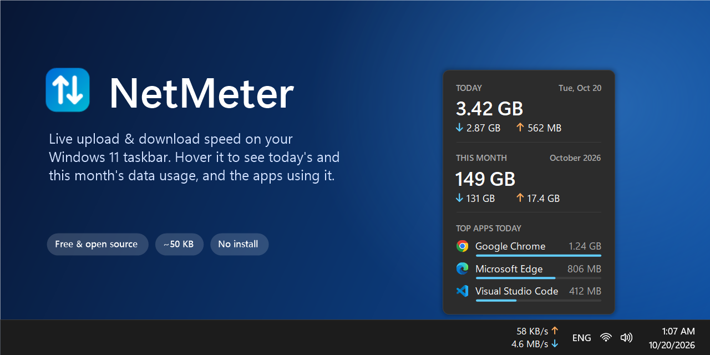
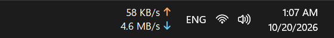
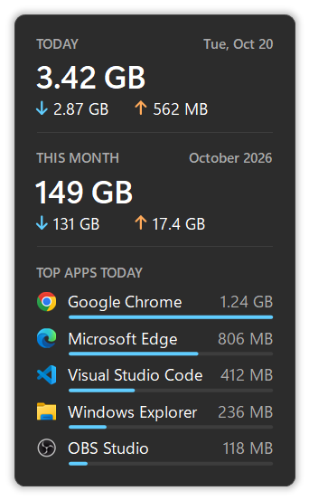
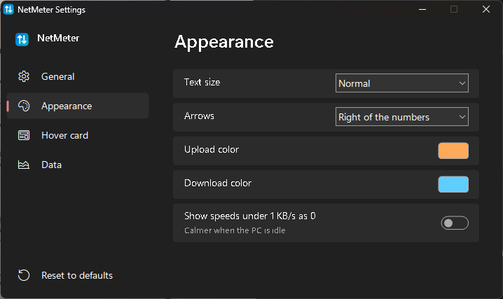

<div align="center">

# NetMeter — network speed meter for the Windows 11 taskbar

**See your live upload and download speed next to the clock, and how much internet data you used today and this month.**
Free, open source, ~50 KB, no install.

[](https://github.com/ehabmansour1/NetMeter/releases/latest)
[](https://github.com/ehabmansour1/NetMeter/releases)
[](#install)
[](LICENSE)
[](https://github.com/ehabmansour1/NetMeter/actions)



**[⬇ Download NetMeter.exe](https://github.com/ehabmansour1/NetMeter/releases/latest)**

</div>

## Why NetMeter

Windows 11 has no built-in internet speed indicator on the taskbar, and classic tools like NetSpeedMonitor stopped working with the new taskbar. NetMeter brings it back, the Windows 11 way:

- **Live upload ↑ / download ↓ speed** on the taskbar, updated every second.
- **Data usage on hover** — today and this month, split into download and upload. The numbers come from Windows itself (the same data as *Settings → Network & internet → Data usage*), so they keep counting even when NetMeter isn't running.
- **Top apps using your internet today**, with their icons — find out what is eating your data.
- **Monthly data cap friendly** — start the month on your **billing day** and count GB the way your ISP does (1000 vs 1024).
- **Looks native** — Windows 11 fonts, ClearType text that matches the clock, light/dark theme, hides in full-screen games and videos.
- **Never covers your apps** — sits next to the tray and shrinks to fit when your taskbar fills up.
- **Tiny and private** — ~50 KB single exe, no install, no admin, no internet access, no telemetry.

<p align="center">
  
</p>

## Install

1. [Download `NetMeter.exe`](https://github.com/ehabmansour1/NetMeter/releases/latest) and put it in a folder you keep, e.g. `C:\Users\<you>\NetMeter\`.
2. Run it. Windows SmartScreen may say *"Windows protected your PC"* because the exe isn't code-signed yet — click **More info → Run anyway**.
3. That's it. The first run sets NetMeter to **start with Windows** (per-user, no admin). If you move the exe later, run it once from the new place.

**Uninstall:** right-click the meter → **Settings…** → turn off *Start with Windows* → right-click → **Exit**, then delete the exe.

Requirements: Windows 11 with .NET Framework 4.8, which is built into Windows. (Windows 10 is untested.)

## Hover card



Rest the mouse on the meter to see:

- **Today** — total data used, with download and upload.
- **This month** (or your **billing month**) — the same for the month so far.
- **Top apps today** — the 3, 5 or 10 apps that used the most data, with bars.

Everything on the card can be turned on or off in Settings — for example, show only the two totals.

<br clear="right">

## Settings

Right-click the meter → **Settings…**. Changes apply immediately.

<p align="center">
  
</p>

| Tab | Settings |
|---|---|
| General | Start with Windows · update every 0.5 / 1 / 2 s · bytes (MB/s) or bits (Mbps) |
| Appearance | Text size · arrows right or left of the numbers · upload / download colors · show speeds under 1 KB/s as 0 |
| Hover card | Show the download / upload line or only totals · show top apps · number of apps (3 / 5 / 10) · delay before the card appears |
| Data | 1 GB = 1024 MB (like Windows) or 1000 MB (like ISPs) · day the month starts (match your internet bill) |

Settings are stored in `HKCU\Software\NetMeter`.

## FAQ

**How do I show internet speed on the Windows 11 taskbar?**
Run NetMeter. It adds the upload and download speed next to the clock and starts with Windows from then on.

**How can I see how much data I used this month on Windows 11?**
Hover over NetMeter. Set *Month starts on day* to your bill date to match your ISP's data cap period.

**Which app is using my internet?**
The hover card lists today's top apps by data used.

**Why do the numbers differ from my ISP?**
Windows counts 1 GB as 1024 MB; most ISPs count 1000 MB (about 7% more). Switch *Count 1 GB as* in Settings → Data.

**Is it a NetSpeedMonitor / TrafficMonitor alternative?**
Yes — NetMeter is a lightweight Windows 11 alternative focused on taskbar speed and data usage, with no install.

**Does it work with Wi-Fi, Ethernet and mobile hotspots?**
Yes. Speed counts all physical adapters (virtual adapters like Hyper-V and VPN tunnels are skipped so nothing is counted twice).

**Does NetMeter send my data anywhere?**
No. It never connects to the internet — see [Privacy](#privacy).

## Build from source

Uses the C# compiler that ships with Windows — nothing to install:

```powershell
powershell -ExecutionPolicy Bypass -File build.ps1
```

Release builds are made by GitHub Actions (`.github/workflows/build.yml`) from the tagged source.

Developer options: `NetMeter.exe --dump usage.txt` writes the usage numbers to a file, `--card card.png` saves the hover card as an image, and `--demo docs` redraws the README images with sample data.

## Privacy

NetMeter does not send any data anywhere. It only reads Windows' local network counters and data-usage records, and this program will not transfer any information to other networked systems unless specifically requested by the user. Its only stored data is its settings, in `HKCU\Software\NetMeter`.

## Code signing policy

Free code signing provided by [SignPath.io](https://about.signpath.io), certificate by [SignPath Foundation](https://signpath.org).

- Committers and reviewers: [ehabmansour1](https://github.com/ehabmansour1)
- Approvers: [ehabmansour1](https://github.com/ehabmansour1)

Only release builds produced by this repository's GitHub Actions workflow from tagged source are signed, and each signing request is approved manually.

## Notes

- Windows 11 doesn't let apps embed into the taskbar, so NetMeter is a small always-on-top window placed just left of the tray icons.

## License

[MIT](LICENSE) © Ehab Mansour
